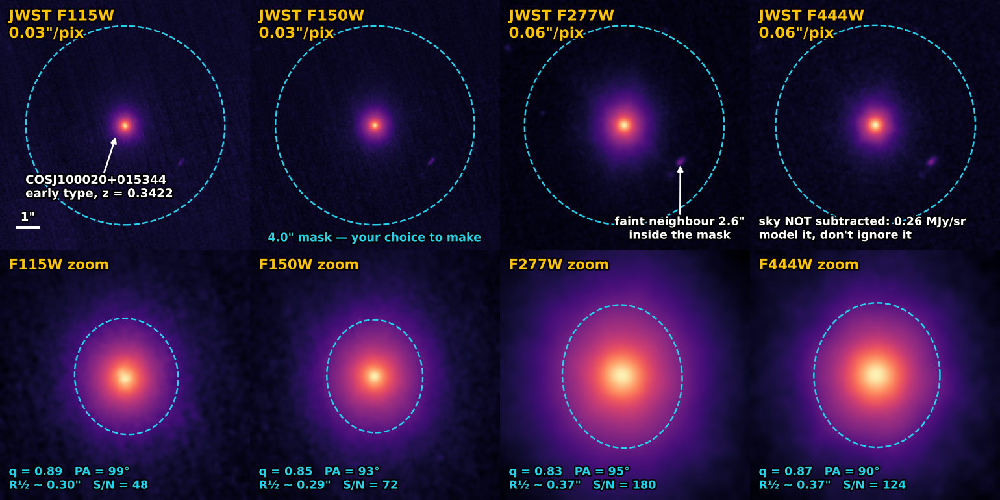

# PyAutoGalaxy Assistant

This repository is the **PyAutoGalaxy Assistant**: an AI assistant which **lets you use natural language** to study
the structure and morphology of galaxies with [PyAutoGalaxy](https://github.com/PyAutoLabs/PyAutoGalaxy), by fitting
their light in imaging and interferometer data.

It covers surface-brightness profiles, multi-Gaussian expansions, bulge–disk decomposition, isophote and ellipse
fitting, pixelised reconstructions of clumpy galaxies, and multi-wavelength analysis.

## Getting Started

The assistant runs inside an **AI coding agent**, a tool that can read this repository, run Python on your computer
and look at the results. Pick your agent:
[Claude Code](https://github.com/PyAutoLabs/PyAutoScientist/blob/main/AI_OPTIONS.md#claude-code-recommended-paid) or
[Codex](https://github.com/PyAutoLabs/PyAutoScientist/blob/main/AI_OPTIONS.md#codex-recommended-paid) are recommended,
and [GitHub Copilot CLI](https://github.com/PyAutoLabs/PyAutoScientist/blob/main/AI_OPTIONS.md#github-copilot-cli) or
[OpenCode](https://github.com/PyAutoLabs/PyAutoScientist/blob/main/AI_OPTIONS.md#opencode) are free AI options if you
want to try it without paying.

Once it is installed, download this repository and open your AI coding agent inside it, then paste in the starting
prompt below. The assistant installs **PyAutoGalaxy** for you if it is missing.

```bash
git clone https://github.com/PyAutoLabs/autogalaxy_assistant.git
cd autogalaxy_assistant
claude        # or: codex
```

### Using PyAutoGalaxy Assistant

To illustrate the `autogalaxy_assistant` we will use James Webb Space Telescope NIRCam imaging of
**COSJ100020+015344**, whose four-band cutout ships with this repository in `dataset/imaging/cosj100020+015344`:



It is a single bright, smooth, early-type galaxy at a spectroscopic redshift of z = 0.3422: one object, four
wavebands, and no bright companion to complicate things. That makes it a clean first target, but there are still
three things to decide:

- **How far out the mask reaches.** A mask that cuts off the outer light biases the effective radius and Sersic
  index, so the 4" circle in the figure is a starting suggestion, not an answer. The assistant will ask you about it.
- **The sky has not been subtracted.** The data carry the real JWST background as a positive pedestal, 5 to 19 times
  the noise depending on the band. A fit that ignores it absorbs the pedestal into the profile's outskirts and
  returns an inflated size and Sersic index. Free `background_sky_level` on an `af.Model(ag.DatasetModel)`, or
  subtract the measured value first.
- **There is a faint neighbour 2.6" from the centre**, inside any mask wide enough to reach the galaxy's outer light.
  It has to be masked or modelled, not ignored.

The galaxy's measured shape (axis ratio ~0.83–0.89, position angle ~90–99°, drifting with wavelength) is shown in the
zoomed bottom row of the figure, and every number in it is read from the dataset's `info.json`. The full story, from
the MAST exposures through the reduction to each measurement, is in
[the dataset's README](dataset/imaging/cosj100020+015344/README.md). It includes the caveat that matters most: the
PSF shipped with the data is a model (STPSF) PSF rather than an empirical one, and it is the biggest source of
systematic error in any fit to this data.

### Starting prompt

If you've not used PyAutoGalaxy before, use the prompt below. The assistant plots the data, then explains the
physics and the different ways you could model the galaxy, pointing you to the tutorials as it goes.

<sub><b>Starting prompt for Claude Code, Codex or other AI coding agent</b></sub>

```text
Find the bundled JWST imaging of the galaxy COSJ100020+015344 in
dataset/imaging/cosj100020+015344, give me a short script that plots all four wavebands,
and then — since I'm new to PyAutoGalaxy — give me an overview of the different ways we
could model the structure of an early-type galaxy at z = 0.34.
```

### Already know PyAutoGalaxy?

This prompt runs a real multi-band structural measurement, including the sky pedestal the data actually has. The
assistant will ask you about the mask and the faint neighbour before it starts fitting, and it does that on purpose.

<sub><b>Example Natural Language Prompt for Claude Code, Codex or other AI coding agent</b></sub>

```text
Assistant mode.

Fit the JWST F277W imaging in dataset/imaging/cosj100020+015344 with a multi-Gaussian
expansion (MGE) bulge, freeing the background sky level — the sky is not subtracted in
this data. Report the effective radius, axis ratio and position angle, add a single-Sersic
fit so I get a Sersic index to compare against, and then tell me how the recovered
structure changes across the other three wavebands.
```

## Customize Your Assistant

The `autogalaxy_assistant` adapts its behaviour to suit your prompt:

- Want to plan your analysis and compare the available approaches before running anything? Simply say so in your
  opening prompt.

- Want the assistant to ask questions as it goes, helping you understand the analysis and make informed choices? Ask
  it to guide you through the process.

- Want it to complete a task end-to-end without consulting you? Tell it to **one-shot** the task.

### Teacher Mode

If you are new to galaxy structure and morphology, particularly an undergraduate or early-stage PhD student, start
your prompt with `Teacher mode.` The assistant will explain the fundamentals of fitting a galaxy's light in more
detail, and link you to relevant, human-readable documentation so you can see what **PyAutoGalaxy** is doing.

### More about the assistant

- [What works today, and what is coming](docs/whats_available.md): the skills, reference material, dataset and HPC
  support available now, and what isn't there yet.

## Scientific Context

The assistant knows more than the PyAutoGalaxy API. It ships with a **literature wiki** (`wiki/literature/`) on galaxy
structure, with pages on the key concepts, the main surveys and instruments, and annotated bibliographies. Every
reference in it was checked against a public record before it was added.

Before you start a serious analysis, add the papers that matter for your own work. Just point the assistant at them
and it will read and file them for you:

<sub><b>Example Natural Language Prompt for Claude Code, Codex or other AI coding agent</b></sub>

```text
Ingest the following paper into the literature wiki so you can use it
when we talk about bulge–disk decomposition:

  arXiv:2401.01234

(Or, if you have the PDF locally: /path/to/paper.pdf)

Once it's ingested, summarise the paper and how it complements similar
works in the literature wiki.
```

## Science Project

When you start a real scientific study, ask the assistant to set up a **science project**. This is a tidy folder,
backed by its own GitHub repository, that holds everything for that study: the data, the configuration, the analysis
scripts, the results, the plots and a record of your conversations with the assistant.

- **Readable.** Every script the assistant writes is documented and can be turned into a Jupyter notebook.
- **Shareable.** Collaborators can open the GitHub repository to see where the project stands and build on it.
- **Reproducible.** If the work becomes a paper, the repository is its open-source companion.

To start one, just ask:

<sub><b>Example Natural Language Prompt for Claude Code, Codex or other AI coding agent</b></sub>

```text
Start a science project for my COSJ100020+015344 structural analysis.
```

## Conversational Assistants

You can also talk to the assistant in an ordinary chat, by connecting this repository to ChatGPT or Claude through
their GitHub connector. This works well for asking questions, planning an analysis and discussing papers, but a chat
cannot run code or look at your data, so for fitting galaxies use a coding agent. The
[PyAutoLabs AI options page](https://github.com/PyAutoLabs/PyAutoScientist/blob/main/AI_OPTIONS.md#chat-instead-of-an-agent)
shows how to set it up.

## The Sibling Assistant

If your science is strong gravitational lensing rather than galaxy structure, use the
[PyAutoLens Assistant](https://github.com/PyAutoLabs/autolens_assistant). It works the same way, built on PyAutoLens.

## Benchmarks

To compare agents and models fairly, the second prompt above is also saved as a fixed **benchmark prompt**,
alongside medium, hard and teacher prompts, each with a scoring rubric in [`benchmarks/`](benchmarks/README.md).
**No run has been scored yet**, so nothing here is a measured performance claim for any agent or model.

## License

This repository is released under the [MIT License](LICENSE), consistent with the wider PyAuto\* ecosystem. The
assistant ships agent instructions and reference material derived from the public PyAuto\* repositories; the
underlying libraries are released under their own licenses (see each repo). The bundled dataset was reduced from
public JWST archival observations; see [its README](dataset/imaging/cosj100020+015344/README.md) for the archive
identifiers and catalogue citations.

<details>
<summary><sub>Note for AI coding agents</sub></summary>

If you are not already inside this repository, clone it
(`git clone https://github.com/PyAutoLabs/autogalaxy_assistant.git && cd autogalaxy_assistant`), then read
`AGENTS.md` in full and follow it. Hooks and project settings do not load for a folder cloned mid-session, so run the
code gate yourself (`python autoassistant/audit_skill_apis.py --code "<snippet>"`) before running PyAutoGalaxy code.
The mask and contaminant gate on real data is never waived.

</details>

<sub><i><a href="https://open.spotify.com/track/6LeTQu4NvTnLRRiB8GVFQe">if you don't know, don't worry</a></i></sub>
